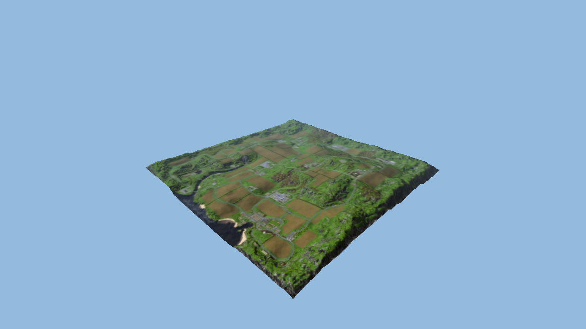
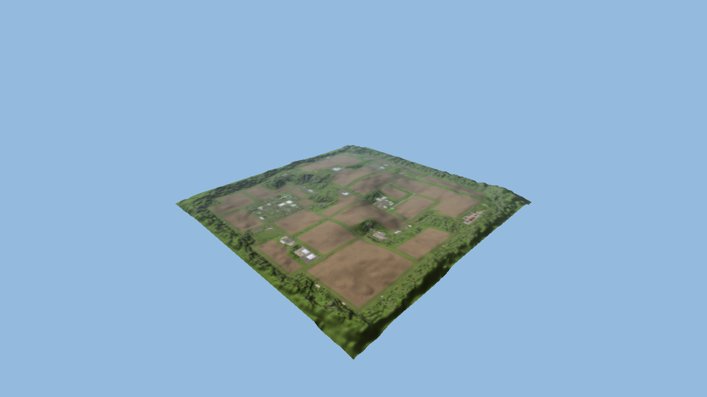

# FS15 Reconstruction

Early-stage reverse engineering and component reconstruction of **Farming
Simulator 15 for Windows**, based on a locally installed copy of version
**1.4.2.0**.

**This is not a complete game rebuild. An authored native terrain engine
can be compiled; the full original engine and farming simulation remain incomplete.**

## Current results

- **Rebuilt frontend executable:** opens the recovered `MainScreen` in a
  Windows window without starting the original game executable or Steam.
  Runs 36 recovered Lua sources with authored XML, rendering, input and
  read-only save services. Career displays twenty slots and existing save
  metadata; empty slots lead to three difficulty choices and two base-map
  previews. Credits/Back and Quit work. Start launches the new terrain engine
  for an empty-slot selection; existing saved simulations cannot be loaded yet.
- **Native 3D engine foundation:** a separate authored Direct3D 11 executable
  renders both original height maps with a free camera. Each terrain has
  524,288 triangles and uses the map overview image as a temporary surface
  texture. External buildings/vehicles, original terrain materials and physics
  are still deferred. See [engine bootstrap notes](docs/ENGINE_BOOTSTRAP.md).
- **Reconstructed C++ launcher:** reads the game's startup XML, chooses the
  x86 or x64 executable, and forwards command-line arguments. It still runs
  the original installed game engine.
- **Reconstructed engine routine:** an RLE8 decoder that writes packed bit
  values. Compiled and compared with the original native routine in
  **266 cases covering 853,086 decoded values**, including 64 KiB memory
  segment boundaries.
- **Analysis tools:** installation inventory, PE metadata and strings,
  a code-section snapshot tool, and reproducible Ghidra exports.
- **Initial analysis:** 12,166 native functions catalogued; 249 pseudocode
  exports in an initial selection and 44 in an overlapping focused selection.
- **Lua interface mapping:** 112 observed name/implementation/wrapper
  associations from one registration routine.
- **GAR extraction:** 1,121 local files recovered from `dataS.gar` and
  `dataS2.gar`, including all 470 LuaJIT chunks found in these archives.
- **Lua recovery and rebuild:** all 470 recovered Lua sources compile.
  **254** reproduce the original stripped bytecode exactly; **216** pass
  syntax checks but still need behavioral validation. A local rebuilt
  script package is generated without replacing installed game files.

Function counts include runtime and third-party library code. They are not
a measure of game reconstruction completeness. See [the project status](analysis/STATUS.md)
for evidence, limitations, and the next targets.

Track completed work and remaining milestones in the
[project checklist](PROJECT_CHECKLIST.md).

## Current 3D renders

Captured directly from the rebuilt Direct3D 11 runtime. This milestone shows
the original terrain relief with the overview image as a temporary texture;
buildings and trees in these images are not separate 3D objects yet.

### Bjornholm



### Westbridge Hills



The next reconstruction work follows original GIANTS Engine 6 resources and
native behavior: map coordinates, scene hierarchy, binary meshes and materials.
Original components may be used locally as references or runtime bridges where
practical; authored replacement code is identified separately.

## Repository contents

| Path | Purpose |
|---|---|
| `src/launcher/main.cpp` | Compilable behavioral reconstruction of the launcher |
| `src/core/rle8.cpp` | Compilable RLE8 engine routine |
| `src/menu/` | Independently compiled GUI host and authored recovered-menu bootstrap |
| `src/engine/` | Authored Direct3D 11 terrain runtime, I3D metadata and resource loaders |
| `scripts/inventory.py` | Read-only inventory, local binary copies, PE reports, and SDK example extraction |
| `scripts/runtime_snapshot.py` | Capture only the normally loaded game's code section for analysis |
| `scripts/analyze.ps1` | Ghidra headless runner |
| `scripts/ghidra/` | Function, reference, and pseudocode export scripts |
| `scripts/check_rle.py` | Differential tests against a locally recovered native reference |
| `scripts/map_bindings.py` | Index observed Lua registrations |
| `scripts/gar.py` | Reconstructed GAR 5.3 header/index parser and script transform |
| `scripts/native_gar.py` | Version-pinned original cipher oracle; still depends on a local game code snapshot |
| `scripts/extract_gar.py` | Local extraction, hashes, XML diagnostics, and script normalization |
| `scripts/recover_lua.py` | Strict decompilation, recompilation checks, and bytecode comparisons |
| `scripts/compile_recovered_lua.py` | Build the local recompiled script package |
| `scripts/package-menu.ps1` | Validate and package the directly runnable local frontend |
| `scripts/prepare-engine-assets.ps1` | Copy six map inputs from the local installation |
| `scripts/verify-engine-package.ps1` | Verify native rendering and package parity for both maps |
| `src/menu/savegames.cpp` | Read-only save metadata snapshots and explicit mutation rejection |
| `scripts/verify_workspace.py` | Check hashes and provenance relationships in local outputs |
| `tools/bootstrap_ghidra.py` | Download and verify a pinned official Ghidra release |

Original game executables, archives, assets, SDK files, memory snapshots,
raw decompiler exports, and downloaded tools are **not included**. Generate
them locally from your own installation. This repository contains authored
source, analysis tools, documentation, and selected validation metadata.

## Build

Requirements: 64-bit Windows, CMake, and Visual Studio with the C++ desktop
workload and a Windows SDK. Development was validated with MSVC 19.51 and
Windows SDK 10.0.26100. The C++ runtime is linked statically.

```powershell
.\scripts\build.ps1
.\FS15LauncherRebuilt.exe --self-test
.\FS15LauncherRebuilt.exe --dry-run --game-dir 'D:\SteamLibrary\steamapps\common\Farming Simulator 15'
```

CMake uses its default Visual Studio generator. Select another explicitly:

```powershell
.\scripts\build.ps1 -Generator 'Visual Studio 17 2022'
```

The build produces `FS15LauncherRebuilt.exe`, `FS15Core.dll` and
`FS15EngineRebuilt.exe`, plus the frontend when LuaJIT is available, and runs CTest.
The launcher has nine behavioral checks. If the local native RLE reference
exists, the build also requires Python 3.11+ and runs the differential tests.
Pass `-PythonExe 'C:\path\to\python.exe'` to select the interpreter.

To start the installed game through this launcher, remove `--dry-run`.
Keep Steam available. This uses the **original game executable**. Set the
installation path with `--game-dir` or `FS15_GAME_DIR`; otherwise it defaults
to Steam's usual installation directory on C:.

### Launch the reconstructed frontend

After script/asset recovery below, run:

```powershell
.\scripts\setup_lua_tools.ps1
.\scripts\package-menu.ps1 -GameDir $env:FS15_GAME_DIR -PrepareOnly
.\scripts\build.ps1 -PythonExe 'C:\path\to\python.exe'
.\scripts\package-menu.ps1 -GameDir $env:FS15_GAME_DIR
.\build\FS15EngineAlpha\FS15MenuRebuilt.exe
```

The preparation step copies the installed bitmap fonts, base-map previews and terrain inputs before the
build's menu test runs. The menu target is enabled when
the pinned local LuaJIT static library exists. To build the other components
without it, use `-DFS15_BUILD_MENU=OFF` in CMake.

The local folder contains both executables, bootstrap, recovered Lua sources,
assets and LuaJIT copyright notice. A ZIP is generated at
`build/FS15MenuRebuilt-local.zip`. Both stay excluded from GitHub. Keep the
folder together; the executable finds resources beside itself regardless of
the working directory. No original game executable, runtime code snapshot,
archive cipher oracle or Steam process is required **to run this frontend and terrain engine**.

Mouse, wheel and arrow/Enter input use the recovered GUI's hit testing, focus
and callbacks. Career shows twenty slots, existing money/duration/map/date
metadata, and explicit unavailable labels for unsupported metadata. Save
files are read only; Delete is disabled. An empty slot opens the recovered
Difficulty and Map Selection screens. Start opens the native terrain window
without creating a save or starting simulation. Credits/Back and Quit also work.
Use WASD/ZQSD or arrows to move, mouse drag to look, Space/Ctrl for height,
Shift for speed and Home to reset the view.

Interactive runs read the local Windows Documents/My Games/FarmingSimulator2015
profile. Override it with `--save-dir PATH`, or use `--empty-saves` for empty
slots. Smoke tests default to empty slots and inject authored metadata only
for deterministic input checks. Preview a screen explicitly:

```powershell
.\build\FS15EngineAlpha\FS15MenuRebuilt.exe --empty-saves --screen MapSelectionScreen
```

Other screens report their requested destination. The full `main.lua` startup, complete game worlds,
physics, networking, audio and multiplayer remain outside this milestone.
See [menu reconstruction notes](docs/MENU_RUNTIME.md).

## Reproduce the local analysis

Requirements: Python 3.11+, JDK 21, and a local FS15 1.4.2.0 installation.
The Python tools use the standard library. Configure your own paths:

```powershell
$env:FS15_GAME_DIR = 'D:\SteamLibrary\steamapps\common\Farming Simulator 15'
$env:JAVA_HOME = 'C:\path\to\jdk-21'

py -3 scripts\inventory.py
py -3 tools\bootstrap_ghidra.py
.\scripts\analyze.ps1 -Target launcher -Limit -1

# Start the installed game normally through Steam and capture its code section.
py -3 scripts\runtime_snapshot.py --launch-game --via-steam
.\scripts\analyze.ps1 -Target game-runtime -Limit 250 -TimeoutSeconds 300

# Export from the existing project without re-running analysis.
.\scripts\analyze.ps1 -Target game-runtime -Existing -ExportName game-focus -Limit 80 -Addresses '140011a30','1400149d0','14001ea90','14002b8c0','140096580','140098630','14028f430','14028f770'
.\scripts\analyze.ps1 -Target game-runtime -Existing -ExportName native-leaf -LeafReference '14028f430'
Copy-Item inputs\reference\rle8-reference.json analysis\rle8-reference.json
Copy-Item inputs\reference\rle8-reference.asm analysis\rle8-reference.asm
py -3 scripts\map_bindings.py
py -3 scripts\verify_workspace.py
```

Pass `--game PATH` to the inventory or snapshot tool to override the game
directory, `--steam PATH` for a different Steam executable, and `-JavaHome PATH`
to the analysis runner to override `JAVA_HOME`.

The bootstrap downloads [Ghidra 11.4.2 from the official release](https://github.com/NationalSecurityAgency/ghidra/releases/tag/Ghidra_11.4.2_build)
and checks the published SHA-256 before extraction:

```text
795a02076af16257bd6f3f4736c4fc152ce9ff1f95df35cd47e2adc086e037a6
```

The scripts do not overwrite installed game binaries. Starting the game
normally can update its usual user profile. The snapshot copies only `.text`
into a local analysis image, not the heap, writable state, or other modules.
That image is an analysis input, **not a rebuilt executable**.

Ghidra `.c` files are pseudocode with inferred types and generated names;
they are not original source files and do not compile directly. Preserve
binary hashes, addresses, and raw exports separately from each reconstructed
implementation. Local inputs and generated reports are excluded by `.gitignore`.

## Recover and rebuild the script layer

After creating the verified native image above, place local copies of
`dataS.gar` and `dataS2.gar` in `inputs/archives/`. Then run:

```powershell
py -3 scripts\extract_gar.py inputs\archives\dataS.gar --decode-luajit --validate-xml
py -3 scripts\extract_gar.py inputs\archives\dataS2.gar --decode-luajit --validate-xml
py -3 scripts\verify_recovered_files.py
.\scripts\setup_lua_tools.ps1
py -3 scripts\recover_lua.py
py -3 scripts\compile_recovered_lua.py
```

The tool setup uses pinned revisions of [LuaJIT](https://github.com/LuaJIT/LuaJIT)
and [LJD](https://github.com/Dr-MTN/luajit-decompiler), retained locally with
their upstream licenses. LuaJIT is built for Windows x64 with `nogc64 static`
to match the observed chunk architecture. See `analysis/lua-toolchain.json`.
The authored adapter `scripts/ljd_driver.py` fixes repeated literal AST nodes
without modifying the third-party checkout. A synthetic regression fixture
round trips to identical bytecode.

Outputs remain local:

- `recovered/gar/`: extracted assets and original compiled scripts.
- `recovered/luajit/`: normalized chunks; all 470 observed chunks already
  used the standard version-2 header and required no transformation.
- `recovered/lua/dataS/`: recovered, compilable Lua source.
- `build/recompiled/dataS/`: recompiled chunks with portable source names.
- `build/FS15ScriptsRebuilt.zip`: 470 rebuilt chunks and validation metadata.

**The GAR cipher has not been independently reconstructed.** Extraction
currently calls two routines from the exact hash-pinned original code image
inside the extraction process. Header/index parsing, bounds/path checks, and
the extraction pipeline are reconstructed code. See [GAR notes](docs/GAR.md).

Lua validation loads/compiles chunks without executing their top-level game
code. `exact_match` compares `string.dump(chunk, true)` from the original
and rebuilt chunks. `syntax_only` proves compilation, not equivalence.
The package is a rebuilt script layer, not a rebuilt native engine or a
playable standalone game. See [Lua recovery notes](docs/LUA_RECOVERY.md).

## Next work

Investigate the 216 Lua round-trip differences, reconstruct the GAR cipher
without original-code execution, and continue documenting the Lua/native
interfaces and extending the menu runtime toward game startup.

The RLE routine does not implement the complete GRLE file format, physics,
rendering, or game simulation. Recovered game assets and Lua sources are
excluded from Git; the repository publishes tools and selected metadata.
