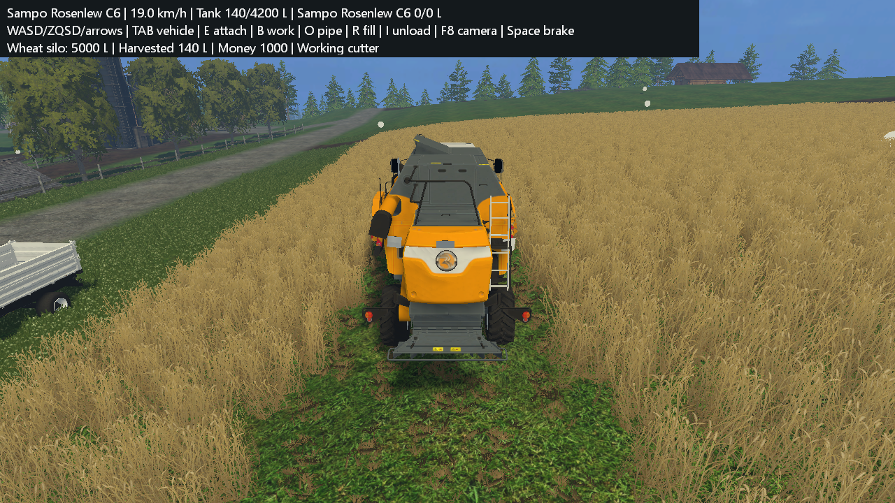
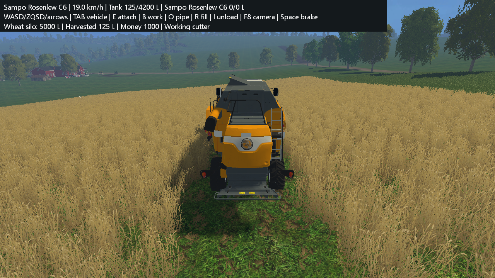
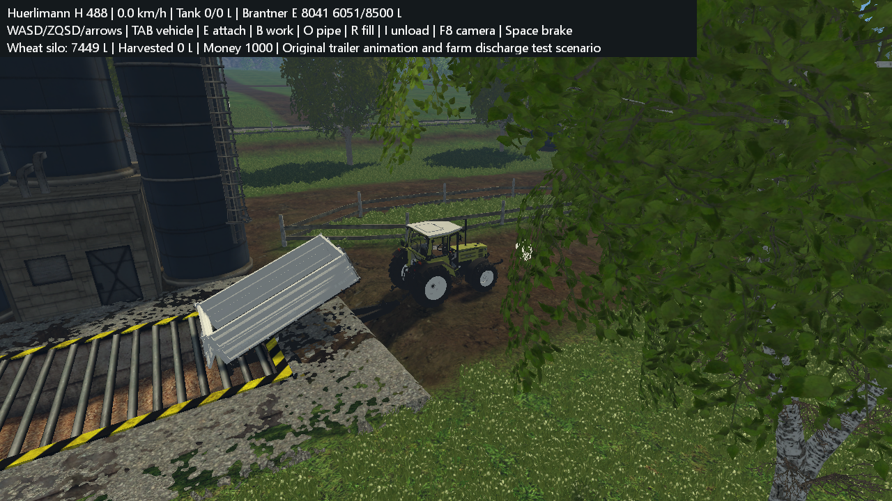
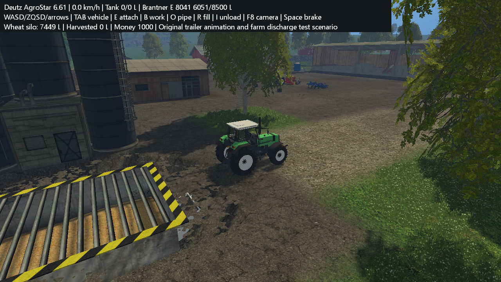
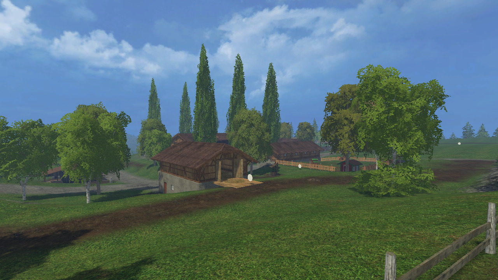
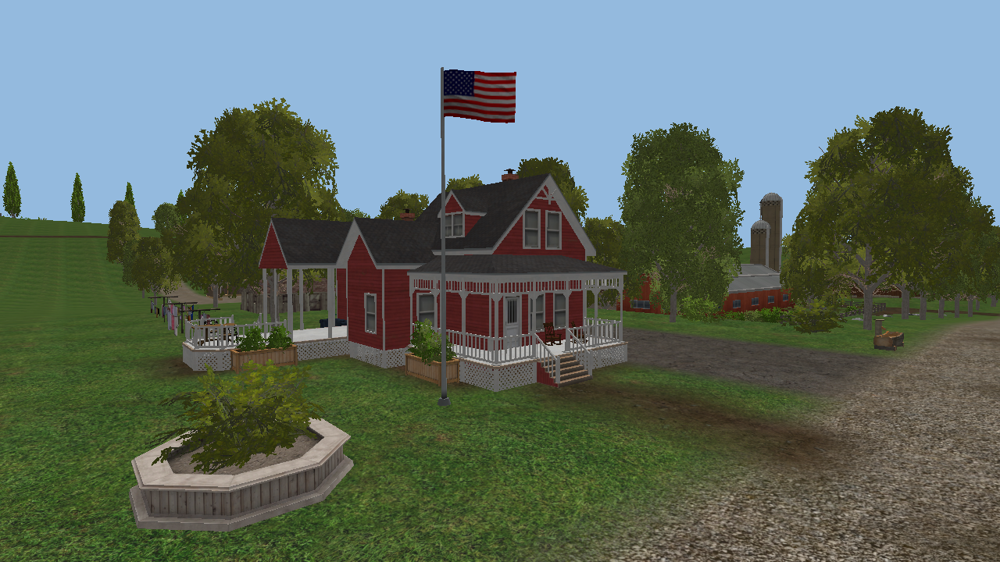
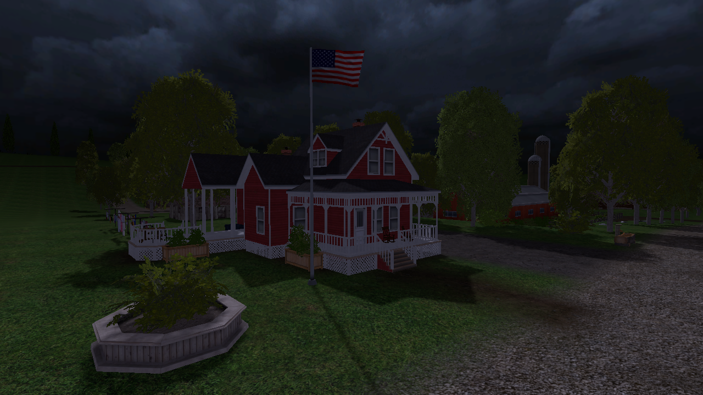
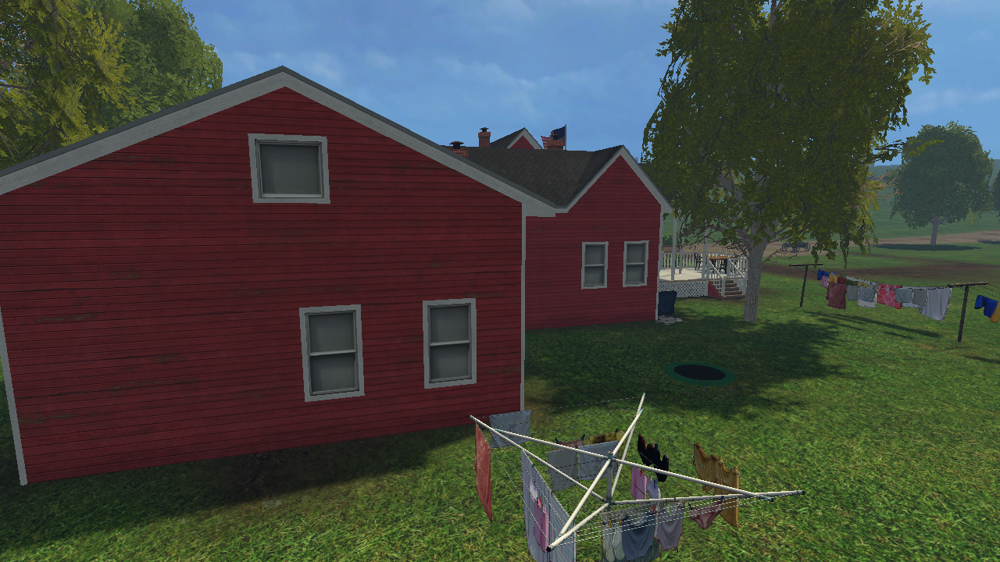

# FS15 Reconstruction

Early-stage reverse engineering and component reconstruction of **Farming
Simulator 15 for Windows**, based on a locally installed copy of version
**1.4.2.0**.

**Source and tooling repository:** original game files, recovered game sources,
raw decompiler exports and playable asset packages are kept local. Reproducing
the game-resource results requires your own FS15 1.4.2.0 installation. The
repository does not provide a ready-to-download copy of the game.

[Progress checklist](PROJECT_CHECKLIST.md) · [Build instructions](#build) ·
[Contributing](CONTRIBUTING.md) · [Project and dependency notices](NOTICE.md)

**This is not a complete game rebuild. The recovered frontend and original
map scenes and an experimental gameplay subset run in a compiled native host;
the full engine and farming simulation remain incomplete.**

The project follows decompilation and reconstruction of the installed GIANTS
Engine 6 game. Original scripts, geometry, textures, scene transforms and native
routines are reused or examined where practical. See the
[reconstruction strategy](docs/RECONSTRUCTION_STRATEGY.md) for component provenance.

**Runtime target: the actual GIANTS Engine 6.** The Direct3D alpha is an
experimental viewer/test host. The native entry point has now reached the
original menu and Bjornholm, with 104 recovered-source helper comparisons
passing inside GE6. See the [native runtime instructions](docs/NATIVE_ENGINE_RUNTIME.md).

**Launch:** build with `scripts/build-launcher.ps1`, then double-click
`Launch FS15.cmd`. The graphical launcher offers GE6 with recovered wheel
helpers, **ReFarm** (the experimental reconstructed engine), and an original-GE6 baseline. It remembers local
settings and keeps native saves under `build/native-engine/profile`.
The **Resources** page detects the local installation and prepares/repairs map,
texture, mesh, recovered-script and starting-fleet caches with progress and
cancellation. See [resource preparation and fresh-workspace requirements](docs/LAUNCHER.md).
See [launcher modes and requirements](docs/UNIFIED_LAUNCHER.md).
The existing `FS15MenuRebuilt.exe` / `FS15EngineRebuilt.exe` packages are the
separate experimental host; they are not the actual-engine entry point.

The launcher has a visual library layout: original-map scene previews, clickable
engine cards, a persistent launch-profile bar and a prominent PLAY button.
**ReFarm** names the authored experimental host; the original GE6 runtime remains
a separate option. Existing executable filenames and the `--mode home` alias are
kept compatible; `--mode refarm` is also supported.

**Experimental local GE6 startup:** choose **Local GE6 (experimental)** under
Settings & activity > Native startup. An isolated modified original runtime now
reaches the original menu and Bjornholm without loading a Steam library. Steam
was already open during the test; a fully closed-client launch and complete
save/reload sessions remain unvalidated. Steam services and licensed DLC are
unavailable. See [preparation, evidence and scope](docs/LOCAL_ENGINE_RUNTIME.md).

## Current results

- **Native recompilation:** 30 uncovered binding targets
  were identified as functions and decompiled. The enlarged catalogue has
  **11,635 eligible exports**, after four additional targets were found in
  constructor-observed scene vtables. A separate portable C++ core now builds the RLE
  decoders, tire math, wheel lookup/read adapters, seven bit operations and the
  native affine point transform. Recovered affine/quaternion math, hierarchical
  world-transform caching and four Lua coordinate adapters bring this to
  **62 native entries on bounded tested paths**. The affine component passes
  36,000 math comparisons, 5,999 complete node-arena comparisons and 4,799
  complete script-frame comparisons against original code, bit for bit.
  ReFarm uses the recovered local/world adapters through an authored matrix bridge.
  Full GE6 linking remains pending; the future
  Switch homebrew target is deferred. See [recompilation scope](docs/NATIVE_RECOMPILATION.md).
- **Scene state recovery:** five native paths now reproduce dirty/visibility,
  clip-distance/mask propagation, observer-presence tracking and base/TRS matrix
  setters. 12,000 complete synthetic node arenas and 7,200 notification traces
  match original code, including 185 world-preserving child matrix changes.
  This is a portable component; native allocators, complete object destruction and arbitrary
  observer side effects are not reconstructed. See [scope](docs/SCENE_STATE_RECOVERY.md).
- **TRS update recovery:** eleven additional entries cover native rotation and
  composition/decomposition, lazy caches and six Lua setters/getters. 18,000 math
  comparisons and 7,200 complete scene arenas pass; all recorded Windows floats
  were bit-identical. Platform libm remains explicit. ReFarm now uses recovered
  TRS/affine math for original I3D nodes, animation hierarchies and vehicle poses.
  See [TRS scope and evidence](docs/SCENE_TRS_RECOVERY.md).
- **Scene hierarchy recovery:** ordered attachment, reparenting and removal now
  reproduce three additional bounded native paths. 19,200 successive complete
  arenas/child buffers and notification traces match the original code. Native
  allocation, object destruction and callback side effects remain open. See
  [hierarchy scope and evidence](docs/SCENE_HIERARCHY_RECOVERY.md).
- **Object lifecycle recovery:** thirteen additional paths initialize base,
  scene, matrix and TRS objects, rename them and destroy supported owned forests.
  Comparisons cover 2,500 constructors, 7,500 renames and 250 recursive forests
  containing 2,470 deleting destructions. Platform allocation, ID/registry and
  known dispatch services are explicit authored boundaries. Nonempty attributes,
  shared resources and active triggers remain open. See
  [lifetime scope and evidence](docs/SCENE_LIFECYCLE_RECOVERY.md).
- **Portability audit:** the current static catalogue has 31,393 known call
  edges. Its scripting roots reach 2,878 eligible functions, including 939 with
  computed calls. Those targets and concrete types still need recovery before
  full linking. Asset-free core tests run on Windows x64, Linux x64
  and ARM64 Linux under QEMU, separately from the future Switch target. See
  [platform evidence](analysis/portable-core-platform-validation.json) and
  [porting blockers](docs/PORTABILITY_STATUS.md).
- **Actual GE6 execution:** the installed original engine initializes its OpenGL
  renderer and physics 5.9.4, opens its frontend and loads Bjornholm in a separate
  profile. The recovered WheelsUtil source executes through the native mod
  loader and passes all 104 helper comparisons. The hybrid mode now activates
  three recovered wheel helpers, with all three called by actual GE6 vehicles
  on Westbridge Hills. Most gameplay remains original; full recovered-game
  replacement is pending. Direct startup of this Steam copy still fails; the
  launcher retains normal Steam startup and an explicit direct mode.
  See the [bounded log evidence](analysis/native-engine-validation.json).
- **Native decompilation coverage:** a full pass through the existing Ghidra
  catalogue exported **11,635 / 11,635 eligible functions** as local pseudocode,
  with no remaining export failures. The last two exports were unblocked with
  larger response capacity and C-only output; 565 thunks or external entries
  are excluded. **498 explicit native scripting API
  descriptors** now guide wheel/physics interface recovery. This is analysis
  coverage, not a recompilable full engine. See [native recovery](docs/NATIVE_RECOVERY.md).
- **Recovered vehicle animations:** original `AnimatedVehicle` and `Trailer`
  loading/update logic now animate doors, trailer bodies and pipes. Tipping waits
  for original discharge timing and automatically closes when empty. Recovered
  source and original bytecode produce identical traces in **777 fixture samples**.
- **Reconstructed tire-force math:** native routine `0x1400c24c0` is now compiled
  from reconstructed C++, with **3,300 native comparisons / 13,200 float outputs**.
  It remains a standalone validated component; contacts, suspension and its
  integration into playable physics are still pending.
- **Experimental gameplay:** original starting fleets, selectable/drivable
  tractors and combine, animated wheels, compatible implement attachment,
  original field/crop data, cutting/cultivation/sowing, silo filling, tipping
  stations, combine-to-trailer transfer and seed refilling now have a running
  native/Lua bridge. Physics, density services and client rendering remain
  partial. No persistent session saves yet. See [gameplay scope and controls](docs/GAMEPLAY_RUNTIME.md).
- **Original density recovery:** the reconstructed 16-bit RLE leaf matches
  original GE6 in **107 comparisons / 35,133,356 values**, including both
  4096-square fruit maps. Crop block meshes and density states are reused.

- **Rebuilt frontend executable:** opens the recovered `MainScreen` in a
  Windows window without starting the original game executable or Steam.
  Runs 36 recovered Lua sources with authored XML, rendering, input and
  read-only save services. Career displays twenty slots and existing save
  metadata; empty slots lead to three difficulty choices and two base-map
  previews. Credits/Back and Quit work. Start launches the new terrain engine
  for an empty-slot selection; existing saved simulations cannot be loaded yet.
- **Original map scene reconstruction:** the Direct3D 11 host renders both
  original terrains, buildings, trees, roads and props. Local `.i3d.shapes`
  decoding recovers **1,155 / 833 meshes**, instanced through the original scene
  hierarchy. Original diffuse textures and **8 / 6 terrain weight layers** are
  loaded at their I3D repeat sizes. The camera starts at the original saved I3D
  viewpoint. Shaders are simplified; mission simulation and physics remain
  incomplete. See [engine notes](docs/ENGINE_BOOTSTRAP.md).
- **Native GE6 mesh-cipher validation:** **128 comparisons / 74,848 bytes**
  against the isolated original routine, including partial blocks and counter carry.
- **Recovered environment/shaders:** the original sky dome/textures, sampled
  Lua environment curves and five original shader injection bodies now run in
  the host. Flags and bushes animate, the hour changes sky/light/fog, and a local
  shadow map casts building/vegetation shadows. Dedicated CTest suites cover this,
  including fixed-image motion/night/shadow comparisons. Full GIANTS cascades
  and mission weather remain incomplete. See [environment notes](docs/ENVIRONMENT_RUNTIME.md).
- **Reconstructed C++ launcher:** reads the game's startup XML, chooses the
  x86 or x64 executable, and forwards command-line arguments. It still runs
  the original installed game engine.
- **Reconstructed engine routine:** an RLE8 decoder that writes packed bit
  values. Compiled and compared with the original native routine in
  **266 cases covering 853,086 decoded values**, including 64 KiB memory
  segment boundaries.
- **Analysis tools:** installation inventory, PE metadata and strings,
  a code-section snapshot tool, and reproducible Ghidra exports.
- **Native catalogue:** 12,200 functions catalogued after binding-target and bounded scene-vtable discovery. The full export supersedes
  the earlier overlapping targeted selections, which remain local references.
- **Lua interface mapping:** 112 observed name/implementation/wrapper
  associations from one registration routine.
- **GAR extraction:** 1,121 local files recovered from `dataS.gar` and
  `dataS2.gar`, including all 470 LuaJIT chunks found in these archives.
- **Lua recovery and rebuild:** all 470 recovered Lua sources compile.
  **308** reproduce the original deterministic stripped bytecode exactly; **162** pass
  syntax checks but still need behavioral validation. A local rebuilt
  script package is generated without replacing installed game files.

Function counts include runtime and third-party library code. They are not
a measure of game reconstruction completeness. See [the project status](analysis/STATUS.md)
for evidence, limitations, and the next targets.

Track completed work and remaining milestones in the
[project checklist](PROJECT_CHECKLIST.md).

## Current 3D renders

### Experimental harvest scenarios

Original combine/cutter, original owned fields and density data. These explicit
test layouts relocate equipment; normal Career uses original fleet placements.
The captured runs harvested 140.4 L / 124.8 L. Physics, crop placement and native
services remain partial. All eighteen CTest suites pass, including the gameplay
and native RLE comparisons.





### Recovered trailer animation

Original Brantner XML and recovered animation/tipping scripts, shown four seconds
into explicit farm-discharge scenarios. Each scenario starts with the original
8,500 L capacity and checks trailer/farm grain conservation. Physics, procedural
grain surfaces and discharge particles remain incomplete.





### Original scene and environment captures

Gameplay scenario captures and their limitations are described in
[the gameplay notes](docs/GAMEPLAY_RUNTIME.md). The earlier scene captures below
remain useful for map/environment comparison.

Captured directly from the reconstructed scene runtime. Buildings, trees,
roads and props use recovered original meshes, placements and diffuse textures.
Terrain uses original height and weight maps. Sky textures and shader injection
bodies are recovered; lighting and shadows use the implemented host services.
Water/materials remain simplified. These are scene-viewer captures, not gameplay.

### Bjornholm



### Westbridge Hills



### Night preview using recovered environment curves



### Local shadow casting



Earlier terrain-only captures remain available for comparison:
[Bjornholm](docs/screenshots/terrain-map01.png),
[Westbridge Hills](docs/screenshots/terrain-map02.png).

## Repository contents

| Path | Purpose |
|---|---|
| `src/launcher/main.cpp` | Compilable behavioral reconstruction of the launcher |
| `src/core/rle8.cpp` | Compilable RLE8 engine routine |
| `src/core/tire_forces.h` | Compilable reconstructed tire-force calculation, validated separately from gameplay |
| `src/menu/` | Independently compiled GUI host and authored recovered-menu bootstrap |
| `src/engine/` | Native scene host, hierarchical I3D transforms, instanced original meshes and terrain layers |
| `src/shape_bridge/` | Local original-mesh staging bridge using pinned MIT I3DShapesTool source |
| `scripts/inventory.py` | Read-only inventory, local binary copies, PE reports, and SDK example extraction |
| `scripts/runtime_snapshot.py` | Capture only the normally loaded game's code section for analysis |
| `scripts/analyze.ps1` | Ghidra headless runner |
| `scripts/index_native_exports.py` | Verify full local exports, index engine descriptors and publish aggregate counts |
| `scripts/ghidra/` | Function, reference, and pseudocode export scripts |
| `scripts/check_rle.py` | Differential tests against a locally recovered native reference |
| `scripts/map_bindings.py` | Index observed Lua registrations |
| `scripts/gar.py` | Reconstructed GAR 5.3 header/index parser and script transform |
| `scripts/native_gar.py` | Version-pinned original cipher oracle; still depends on a local game code snapshot |
| `scripts/extract_gar.py` | Local extraction, hashes, XML diagnostics, and script normalization |
| `scripts/recover_lua.py` | Strict decompilation, recompilation checks, and bytecode comparisons |
| `scripts/compile_recovered_lua.py` | Build the local recompiled script package |
| `scripts/package-menu.ps1` | Validate and package the directly runnable local frontend |
| `scripts/prepare-engine-assets.ps1` | Copy original terrain inputs and material layers |
| `scripts/setup_shapes_tools.ps1` | Fetch/build the pinned upstream mesh decoder with a .NET stream adapter |
| `scripts/prepare_scene.py` | Stage both original mesh caches and textures with local provenance |
| `scripts/stage_environment.lua` | Execute recovered environment curve initialization and AnimCurve locally |
| `scripts/check_shapes_native.py` | Compare the decoder cipher with the isolated original GE6 routine |
| `scripts/verify-engine-package.ps1` | Verify native rendering and package parity for both maps |
| `src/menu/savegames.cpp` | Read-only save metadata snapshots and explicit mutation rejection |
| `scripts/verify_workspace.py` | Check hashes and provenance relationships in local outputs |
| `tools/bootstrap_ghidra.py` | Download and verify a pinned official Ghidra release |

Original game executables, archives, assets, SDK files, memory snapshots,
raw decompiler exports, and downloaded tools are **not included**. Generate
them locally from your own installation. This repository contains authored
source, analysis tools, documentation, and selected validation metadata.

## Build

Requirements: 64-bit Windows, CMake, and Visual Studio with the C++ desktop
workload and a Windows SDK. Development was validated with MSVC 19.51 and
Windows SDK 10.0.26100. The C++ runtime is linked statically. The engine and
frontend require the pinned LuaJIT static library; prepare it before building.

```powershell
git clone https://github.com/nat649/fs15-reconstruction.git
cd fs15-reconstruction
.\scripts\setup_lua_tools.ps1
.\scripts\build.ps1
.\FS15LauncherRebuilt.exe --self-test
.\FS15LauncherRebuilt.exe --dry-run --game-dir 'D:\SteamLibrary\steamapps\common\Farming Simulator 15'
```

CMake uses its default Visual Studio generator. Select another explicitly:

```powershell
.\scripts\build.ps1 -Generator 'Visual Studio 17 2022'
```

The build produces `FS15LauncherRebuilt.exe`, `FS15Core.dll`,
`FS15EngineRebuilt.exe` and the frontend, and runs the locally available CTest suites.
The launcher has nine behavioral checks. If the local native RLE reference
exists, the build also requires Python 3.11+ and runs the differential tests.
Pass `-PythonExe 'C:\path\to\python.exe'` to select the interpreter.

GitHub's **Repository checks** workflow uses only authored synthetic fixtures
and publication guards, with no game assets or native reference image. Its
result is separate from the eighteen-suite local game/native validation.
See [CONTRIBUTING.md](CONTRIBUTING.md) for asset-free checks and submission rules.

To start the installed game through this launcher, remove `--dry-run`.
Keep Steam available. This uses the **original game executable**. Set the
installation path with `--game-dir` or `FS15_GAME_DIR`; otherwise it defaults
to Steam's usual installation directory on C:.

### Launch the reconstructed frontend

After script/asset recovery below, run:

```powershell
.\scripts\setup_lua_tools.ps1
.\scripts\package-menu.ps1 -GameDir $env:FS15_GAME_DIR -PrepareOnly
.\scripts\setup_shapes_tools.ps1
& 'C:\path\to\python.exe' scripts\prepare_scene.py --game-dir $env:FS15_GAME_DIR
& 'C:\path\to\python.exe' scripts\prepare_mission.py --game-dir $env:FS15_GAME_DIR
.\scripts\build.ps1 -PythonExe 'C:\path\to\python.exe'
.\scripts\package-menu.ps1 -GameDir $env:FS15_GAME_DIR
.\build\FS15GameplayAlpha4\FS15MenuRebuilt.exe
```

The mesh preparation tools require Git and the .NET 10 SDK with the ASP.NET
reference pack; the packaged native runtime does not require .NET.
Preparation copies original files and stages geometry locally before the
build's menu/gameplay tests run. The engine's recovered gameplay bridge and the
frontend require the pinned local LuaJIT static library.

The local folder contains both executables, bootstrap, recovered Lua sources,
assets and LuaJIT copyright notice. A ZIP is generated at
`build/FS15MenuRebuilt-local.zip`. Both stay excluded from GitHub. Keep the
folder together; the executable finds resources beside itself regardless of
the working directory. No original game executable, runtime code snapshot,
archive cipher oracle or Steam process is required **to run this frontend and terrain engine**.

Mouse, wheel and arrow/Enter input use the recovered GUI's hit testing, focus
and callbacks. Career shows twenty slots, existing money/duration/map/date
metadata, and explicit unavailable labels for unsupported metadata. Save
files are read only; Delete is disabled. An empty slot opens the recovered
Difficulty and Map Selection screens. Start opens a new experimental session
with original map/fleet/crop data and partial native gameplay services. It creates
no persistent save.
Credits/Back and Quit also work.
Use WASD/ZQSD or arrows to drive, Space to brake, Tab to change vehicle, E to
attach, B to work, R to fill, I to tip and O for the combine pipe. Mouse drag/wheel
orbit/zoom the camera. P pauses/resumes; losing focus or minimizing also pauses
and clears pending input. F8 opens the earlier free camera. See the
[gameplay notes](docs/GAMEPLAY_RUNTIME.md) for limitations and test scenarios.
F5/F6 step the preview hour; F7 toggles local shadows.

Gameplay uses fixed 60 Hz host updates independently of rendering. Both maps
pass original-bytecode/recovered-source comparisons and timing/pause checks
in 24 native runs. See [reliability scope and evidence](docs/GAMEPLAY_RUNTIME.md#timing-pause-and-original-script-comparisons).

Interactive runs read the local Windows Documents/My Games/FarmingSimulator2015
profile. Override it with `--save-dir PATH`, or use `--empty-saves` for empty
slots. Smoke tests default to empty slots and inject authored metadata only
for deterministic input checks. Preview a screen explicitly:

```powershell
.\build\FS15GameplayAlpha4\FS15MenuRebuilt.exe --empty-saves --screen MapSelectionScreen
```

Other screens report their requested destination. The full `main.lua` startup, complete game worlds,
native physics parity, networking, audio and multiplayer remain unfinished.
See [menu reconstruction notes](docs/MENU_RUNTIME.md).

## Reproduce the local analysis

Requirements: Python 3.11+, JDK 21, and a local FS15 1.4.2.0 installation.
The Python tools use the standard library. Configure your own paths:

```powershell
$env:FS15_GAME_DIR = 'D:\SteamLibrary\steamapps\common\Farming Simulator 15'
$env:JAVA_HOME = 'C:\path\to\jdk-21'

py -3 scripts\inventory.py
py -3 tools\bootstrap_ghidra.py
.\scripts\analyze.ps1 -Target launcher -Limit -1

# Start the installed game normally through Steam and capture its code section.
py -3 scripts\runtime_snapshot.py --launch-game --via-steam
.\scripts\analyze.ps1 -Target game-runtime -Limit 250 -TimeoutSeconds 300

# Export from the existing project without re-running analysis.
.\scripts\analyze.ps1 -Target game-runtime -Existing -ExportName game-focus -Limit 80 -Addresses '140011a30','1400149d0','14001ea90','14002b8c0','140096580','140098630','14028f430','14028f770'
.\scripts\analyze.ps1 -Target game-runtime -Existing -ExportName native-leaf -LeafReference '14028f430'
Copy-Item inputs\reference\rle8-reference.json analysis\rle8-reference.json
Copy-Item inputs\reference\rle8-reference.asm analysis\rle8-reference.asm
py -3 scripts\map_bindings.py
py -3 scripts\verify_workspace.py
```

Pass `--game PATH` to the inventory or snapshot tool to override the game
directory, `--steam PATH` for a different Steam executable, and `-JavaHome PATH`
to the analysis runner to override `JAVA_HOME`.

The bootstrap downloads [Ghidra 11.4.2 from the official release](https://github.com/NationalSecurityAgency/ghidra/releases/tag/Ghidra_11.4.2_build)
and checks the published SHA-256 before extraction:

```text
795a02076af16257bd6f3f4736c4fc152ce9ff1f95df35cd47e2adc086e037a6
```

The scripts do not overwrite installed game binaries. Starting the game
normally can update its usual user profile. The snapshot copies only `.text`
into a local analysis image, not the heap, writable state, or other modules.
That image is an analysis input, **not a rebuilt executable**.

Ghidra `.c` files are pseudocode with inferred types and generated names;
they are not original source files and do not compile directly. Preserve
binary hashes, addresses, and raw exports separately from each reconstructed
implementation. Local inputs and generated reports are excluded by `.gitignore`.

## Recover and rebuild the script layer

After creating the verified native image above, place local copies of
`dataS.gar` and `dataS2.gar` in `inputs/archives/`. Then run:

```powershell
py -3 scripts\extract_gar.py inputs\archives\dataS.gar --decode-luajit --validate-xml
py -3 scripts\extract_gar.py inputs\archives\dataS2.gar --decode-luajit --validate-xml
py -3 scripts\verify_recovered_files.py
.\scripts\setup_lua_tools.ps1
py -3 scripts\recover_lua.py
py -3 scripts\compile_recovered_lua.py
```

The tool setup uses pinned revisions of [LuaJIT](https://github.com/LuaJIT/LuaJIT)
and [LJD](https://github.com/Dr-MTN/luajit-decompiler), retained locally with
their upstream licenses. LuaJIT is built for Windows x64 with `nogc64 static`
to match the observed chunk architecture. See `analysis/lua-toolchain.json`.
The authored adapter `scripts/ljd_driver.py` fixes repeated literal AST nodes
and preserves empty-table allocation before subsequent field assignments,
without modifying the third-party checkout. Authored regression fixtures
check evaluation order and round trip to identical bytecode. The table fix
adds 54 exact matches with no loss of the previous 254.

Outputs remain local:

- `recovered/gar/`: extracted assets and original compiled scripts.
- `recovered/luajit/`: normalized chunks; all 470 observed chunks already
  used the standard version-2 header and required no transformation.
- `recovered/lua/dataS/`: recovered, compilable Lua source.
- `build/recompiled/dataS/`: recompiled chunks with portable source names.
- `build/FS15ScriptsRebuilt.zip`: 470 rebuilt chunks and validation metadata.

**The GAR cipher has not been independently reconstructed.** Extraction
currently calls two routines from the exact hash-pinned original code image
inside the extraction process. Header/index parsing, bounds/path checks, and
the extraction pipeline are reconstructed code. See [GAR notes](docs/GAR.md).

Lua validation loads/compiles chunks without executing their top-level game
code. `exact_match` compares deterministic `string.dump(chunk, "sd")` from the
original and rebuilt chunks. This sorts template-table hash entries while
retaining all instructions, constants, prototype order and upvalue metadata.
`syntax_only` proves compilation, not equivalence.
The package is a rebuilt script layer, not a rebuilt native engine or a
playable standalone game. See [Lua recovery notes](docs/LUA_RECOVERY.md).

## Next work

Investigate the 162 Lua round-trip differences, reconstruct the GAR cipher
without original-code execution, and continue documenting the Lua/native
interfaces, original physics/component joints, complete farming behavior and
persistent sessions. The current native gameplay bridge is documented above.

The RLE routine does not implement the complete GRLE file format, physics,
rendering, or game simulation. Recovered game assets and Lua sources are
excluded from Git; the repository publishes tools and selected metadata.
