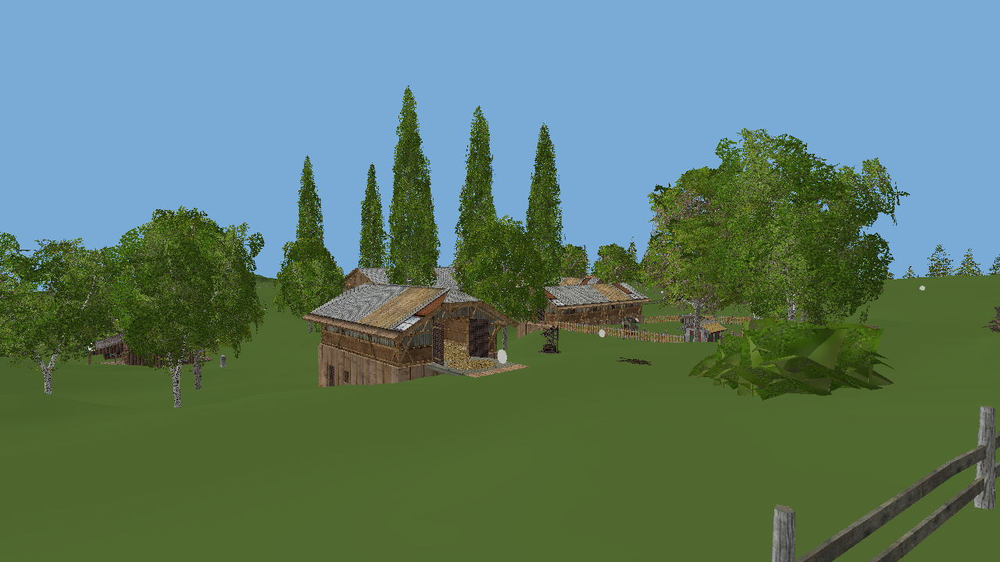

# Original objects through recovered GE6 drawing

`FS15GE6Objects` connects recovered GE6 TRS/hierarchy composition, camera inverse,
perspective/view multiplication, frustum predicates, vertex/index allocation,
indexed subset draw dispatch and buffer destruction. SDL2 supplies the window,
input and GL context. The scene adapter, attribute bindings and fixed-function
material/lighting transport are authored. It does not depend on ReFarm.

Original I3D hierarchy, decoded mesh positions/normals/UVs/indices, per-subset
material IDs, diffuse colors and DDS pixels are retained. A mesh is uploaded once
and shared by its instances. The local staging script converts DDS pixels with
Pillow; it consumes caches from the existing pinned MIT I3DShapesTool adapter.
No original resources or prepared scene packages are distributed in Git.



This is an actual OpenGL framebuffer capture on a Windows NVIDIA GTX 1650,
using the original editor camera. Bjornholm loads 1,155 decoded object meshes,
190 diffuse textures and 338,165 eligible object instances. An additional mesh
uses all 1,050,625 original DEM samples, preserving RG16 heights and two-metre
spacing. The captured frame submits 18,964 object instances plus terrain,
2,884,884 triangles in total after distance/frustum rejection. Submission counts
include occluded geometry, not just pixels visible in the capture.

## Local Windows launch

Requires CMake, an x64 MSVC compiler, Python with Pillow/NumPy, and locally staged
original `recovered/gar/data/maps/map01.i3d`, `.meshes`, DDS and DEM resources.
See [resource preparation](LAUNCHER.md). From the repository directory:

```powershell
python -m pip install Pillow numpy
powershell -File scripts/build-ge6-objects.ps1
```

The build script downloads the official SDL2 2.30.0 VC development archive and
verifies SHA-256
`6413358b67f19b5398e902c576518d5350394a863eb53eb27bb9a81e75a36958`.
Then double-click `Launch GE6 Objects.cmd`. For Westbridge Hills, stage using
`-Map map02` and run the executable with its corresponding `--scene` path.

Controls: WASD/arrows or ZQSD to fly, Space/Ctrl for height, Shift for speed,
right mouse drag to look, Escape to close. This is a free camera, not a player
controller. To capture without leaving a window open:

```powershell
build/ge6-objects-build/src/ge6_objects/Release/FS15GE6Objects.exe --scene build/ge6-objects/map01/scene.ge6scene --capture build/ge6-objects/map01/capture.bmp --frames 1
```

`--camera x y z yaw pitch` overrides the initial view; `--distance 600` sets
the preview distance in metres. Original node transforms are never rescaled.

## Linux build and test

```sh
sudo apt-get install cmake g++ libsdl2-dev libgl-dev python3-pil python3-numpy
cmake -S . -B build/ge6-objects-build -DFS15_PORTABLE_CORE_ONLY=ON \
  -DFS15_BUILD_GE6_OBJECTS=ON -DCMAKE_BUILD_TYPE=Release
cmake --build build/ge6-objects-build --target FS15GE6Objects --parallel 2
python3 scripts/prepare_ge6_objects.py --scene recovered/gar/data/maps/map01.i3d \
  --output build/ge6-objects/map01
build/ge6-objects-build/src/ge6_objects/FS15GE6Objects \
  --scene build/ge6-objects/map01/scene.ge6scene
```

Prepared `scene.ge6scene`, `scene.meshes` and `texture-*.rgba` files can also be
copied together from one's own Windows staging folder to Linux. The adapter
format is little-endian, intended for the current x64/ARM64 targets. Newly built
Linux workflow artifacts include `bin/FS15GE6Objects`; original resources stay
local. The separate frontend tester still does not start a simulated world.

`tests/check_ge6_objects.py` uses asset-free authored triangles and a tiny texture
to verify actual framebuffer colors, inherited placement, shared geometry and
invalid-index rejection. This passes on the Windows NVIDIA context. CI also runs
it with Mesa/Xvfb on Linux; original-map Linux desktop validation is separate.

## Remaining gaps

- Fixed-function lighting, no normal/specular maps, shadows, sky dome or GE6
  shader variants. Texture filtering has no recovered mip/anisotropy policy.
- Temporary foliage alpha cutoff and a fixed LOD0 name policy. Full native
  LOD/visibility/material dispatch and animated vegetation remain unconnected.
- Original DEM geometry has a temporary uniform material. Terrain layer
  blending, crops and water need their GE6 render paths.
- Static scene objects only; fleet creation, animation, vehicle physics and
  recovered Lua mission execution are not connected to this window.
- Authored local resource staging is not the native GE6 I3D/shapes loader.
  Complete startup and a playable native Linux game remain open.

No additional native function is counted as recovered merely by adding this
integration host. It connects previously validated components to visible objects.
