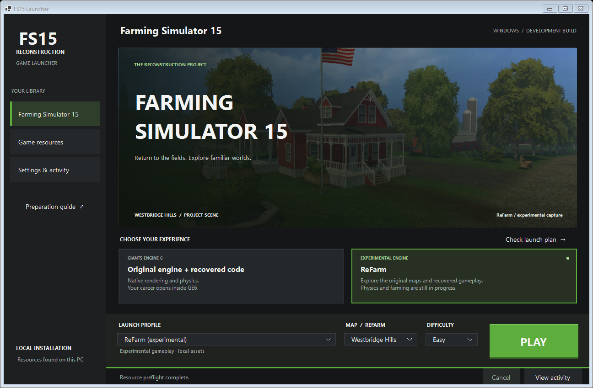

# Launcher and local resource preparation

Build with `scripts/build-launcher.ps1`, then open `Launch FS15.cmd`.
The launcher needs the .NET 10 Windows Desktop runtime and Python 3.11+.
The **Settings & activity** page allows selecting Python and an optional Steam client.
The sidebar links
to Farming Simulator 15, Game resources and Settings & activity. The main view
shows a project scene preview, engine cards and a persistent bottom launch bar.
Choose **ReFarm (experimental)** for the authored reconstructed engine, or a GE6
profile for the installed original engine. Map/difficulty are ReFarm settings;
GE6 careers and maps are still selected inside the native game.



## Prepare resources

1. Open **Game resources** and choose **Detect installation**, or browse to your FS15
   installation. Detection reads Steam libraries and app 313160 manifests, the
   `FS15_GAME_DIR` environment variable and this workspace's saved settings.
2. Choose **Prepare / repair assets**. Progress, errors and cancellation appear
   in the launcher. Keep the installation available until preparation finishes.
3. Return to **Farming Simulator 15**, choose ReFarm, map and difficulty, check the launch
   plan and launch. Build the Windows host first if diagnostics report it missing.

Preparation reuses the existing recovery pipeline. It verifies local archive and
source hashes, prepares original DEM/layer resources, decodes original map and
sky meshes, stages textures, samples recovered environment curves and prepares
original starting fleets and field grids. Matching source files are retained;
generated scene/vehicle caches are regenerated. No game assets are downloaded.
The installed game is read without being modified. Missing pinned LuaJIT,
decompiler or mesh tools are prepared through the existing setup scripts; these
may download third-party sources and require Git, Visual Studio C++ and the .NET
SDK/reference packs described in the build instructions.

Original resources and recovered scripts stay under ignored local `recovered/`.
`build/launcher/assets.json` records status, content hashes and preparation steps.
Interrupted/failed preparation blocks ReFarm startup until repaired. An
operating-system lock prevents concurrent preparations. Source copying uses a
verified temporary file and atomic replacement; interrupted temporary copies can
be repaired on the next run. Redirected output paths are rejected before staging.
Cancellation terminates the preparation process tree; rerun preparation to repair
unfinished generated caches.

**Check resources** is a required-file preflight, not a full integrity scan or
evidence of a rendered game session. Preparation rechecks archive/recovered
source hashes and records staged resource hashes. Separate engine tests verify
loading and rendering.

## Fresh-workspace extraction requirement

Archive decryption still uses the pinned **original native GAR oracle**, not an
independent recovered cipher. If extraction/recovery is missing, preparation needs
the locally captured FS15 **1.4.2.0 x64** analysis image. An absent/unsupported
image produces an explicit error. The launcher does not substitute placeholder
scripts/assets or capture a process as a side effect.

For a fresh workspace, start the installed game normally, then use the existing
read-only analysis tool while that game is running:

```powershell
$env:FS15_GAME_DIR = 'D:\Games\Farming Simulator 15'
python scripts/runtime_snapshot.py --game $env:FS15_GAME_DIR
# Then return to Resources > Prepare / repair assets.
```

The image stays in ignored `inputs/runtime/`; never publish it. A successful
resource import does not mean GE6 has been fully decompiled or recompiled.

The same operations are available without the GUI:

```powershell
python scripts/launcher_assets.py detect
python scripts/launcher_assets.py status
python scripts/launcher_assets.py prepare --game-dir $env:FS15_GAME_DIR
```

## Runtime selection and validation

GE6 baseline/hybrid modes use the installed original engine and its normal
startup requirements. GE6 uses installed assets in place. ReFarm uses
local prepared caches; the renderers run in separate processes. Native career/map
selection happens inside GE6; home mode uses the launcher's map and difficulty.
See [native integration limits](UNIFIED_LAUNCHER.md).

`--smoke-capture PATH` renders all three WinForms pages, both engine selections
and the compact layout, checks the custom profile menu and keyboard/accessibility
selection, and runs detection/preflight without starting a game. Adding `--smoke-prepare` also runs the real
preparation worker against the selected installation. Its JSON report distinguishes
preparation, UI rendering and game startup. Captures stay local and may contain
installation paths.

The two embedded banner images are existing rendered project screenshots; they
are labeled as ReFarm experimental captures. They do not imply original-GE6
rendering fidelity. No Minecraft assets or game-resource payloads are bundled.

For command-line startup, use `python scripts/unified_launcher.py --mode refarm`.
The existing `--mode home` command and `FS15EngineRebuilt.exe` filename remain
compatible. ReFarm is the name of the experimental engine, not the whole project.
