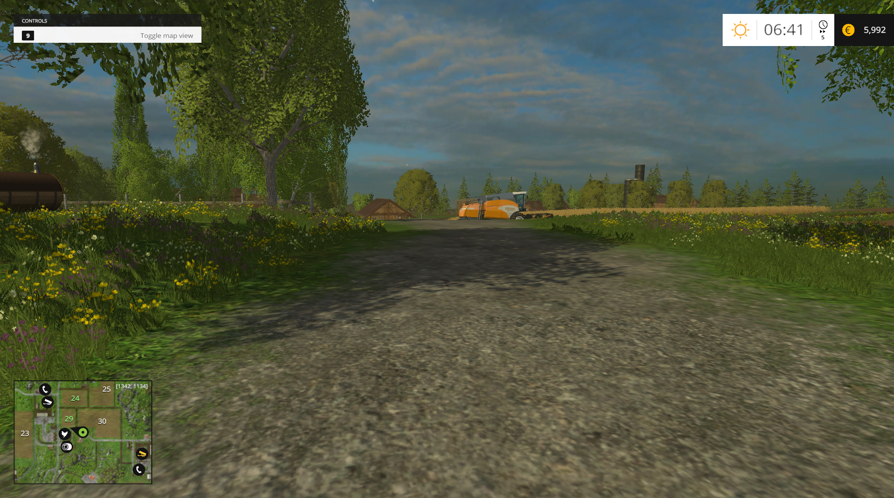

# Experimental local GE6 runtime

The launcher now offers **Local GE6 (experimental)** under **Settings & activity
> Native startup**. This runs an isolated, modified copy of the original FS15
1.4.2.0 x64 runtime with an authored local platform adapter. It is separate from
**ReFarm**, and it is not a fully recompiled GE6 engine.

## Prepare and launch

1. Select the installed FS15 directory in **Game resources**.
2. Choose **Prepare local GE6**. Preparation needs the pinned local native
   analysis image, the recovered WheelsUtil source, CMake and MSVC x64. Original
   resources are copied into ignored `build/ge6-local`; allow several GB of space.
3. In **Settings & activity**, select **Local GE6 (experimental)** as Native startup.
4. Select a GE6 launch profile and choose **PLAY**. Choose Career/map inside GE6.

The existing original/Steam/direct modes and ReFarm remain available. Preparation
refuses a running FS15 session. Original installation files and normal personal
saves are not rewritten; the local mode has its own profile. Licensed `.dlc`
containers are excluded. The profile and restart-safe alias remain local.

```powershell
python scripts/prepare_local_engine.py --game-dir $env:FS15_GAME_DIR --activate-recovered
python scripts/unified_launcher.py --mode hybrid --transport local --game-dir $env:FS15_GAME_DIR
# Once prepared, inspect the command without starting another game:
python scripts/unified_launcher.py --mode hybrid --transport local --game-dir $env:FS15_GAME_DIR --dry-run
python scripts/verify_native_engine.py --local
```

File copies are hash checked. A private source/target size/mtime index avoids
rereading unchanged resource contents on subsequent preparations; changed files
are rechecked and repaired. Interrupted preparations retain an incomplete marker.
Executable/image and adapter hashes are checked separately. This cache is not a
continuous integrity monitor of every installed asset.

## Native and authored boundaries

The original normalized code image remains version/hash pinned and private. The
local image selects the discovered native CRT entry point, retires the original
Steam-only bootstrap wrapper and resolves the observed Steam import names to
`fs15_local.dll`. Only the local copy is changed. The adapter supplies bounded
local/no-op services for the 13 observed imports and a minimal utility table.
Client, user, apps and statistics interfaces are unavailable; initialization does
not pretend that a Steam session exists. No user ID, login, ownership or licensed
DLC entitlement is synthesized. Steam callbacks and achievements are unavailable;
gamepad text input falls back to an unavailable result.

This is a runtime integration experiment around **original native code**, not
recovered engine source. Original executables, snapshots, scripts, resources and
generated binaries stay out of Git. Only authored tooling/adapter code, aggregate
evidence and rendered screenshots are published.

## Observed result and limits

The local session reached the **original menu**, initialized GE6 **6.0.2**,
physics **5.9.4** and OpenGL, then loaded **Bjornholm** with its original HUD and
vehicles visible. The recovered-source probe passed **104 comparisons**, and all
three activated wheel helpers were called by native gameplay. Module inspection
found `fs15_local.dll` and **no Steam-named library** in the game process.
The authored adapter has no Steam or network-library imports.

Steam was already running on the machine and was left untouched. A launch with
the client completely closed has **not** been tested. The module/import checks
and adapter trace establish the exercised local code path; they do not establish
every possible game path. The first Gold DLC attempt correctly failed its license
check; the base-game test excludes that container. Steam services, licensed DLC,
multiplayer and complete save/reload/graphics-restart sessions remain unsupported
or unvalidated in this mode.

See [runtime evidence](../analysis/local-engine-validation.json) and
[recovered-helper evidence](../analysis/local-engine-script-validation.json).


